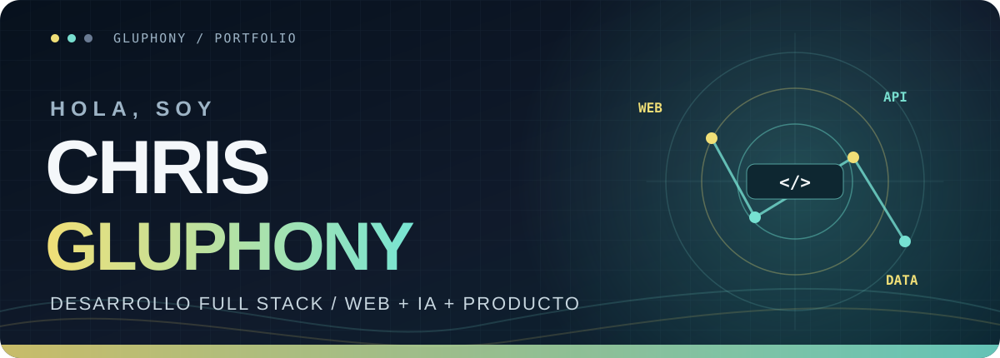
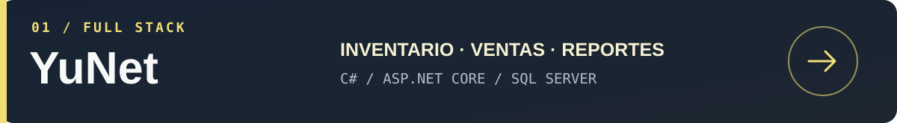
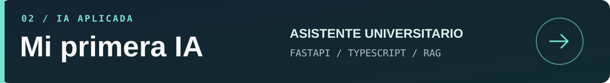
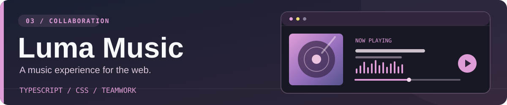

  

    

  
  
  

  
<strong>From the interface to the API to the data behind it.</strong>

  <a href="#about-me">About me</a> &nbsp;·&nbsp;
  <a href="#featured-projects">Projects</a> &nbsp;·&nbsp;
  <a href="#toolbox">Toolbox</a>

---

## About me

I'm **Chris**, a full stack developer who likes following an idea all the way through: from the first screen a person sees, to the API that handles their request, to the data that makes the feature useful. I enjoy building software that solves a real problem and feels straightforward to use.

My projects have taken me from a **commercial management system** to a **document based university assistant** and a **music web app built with collaborators**. That mix has given me room to work with interfaces, backend logic, databases, and teamwork. I learn by making things, testing ideas, and improving what I build.

> **Right now:** exploring Flutter and React Native, and learning Docker. I'm interested in full stack opportunities where I can keep growing while contributing to a product people actually use.

## Featured projects

**YuNet** is a team project for managing products, inventory, purchases, orders, and reports. It uses **C#, ASP.NET Core, and Microsoft SQL Server** with separate presentation, business logic, entity, and data layers. The [branch with the most complete implementation](https://github.com/Gluphony/YuNet/tree/rama_de_intento_de_Reporte) shows these modules.

**My First AI** is a virtual assistant for the University of Managua. It connects a **TypeScript** interface to a **FastAPI** backend, retrieves information from documents to answer questions, and includes registration, conversations, and usage reports.

**Luma Music** is a collaborative music website inspired by streaming platforms, built primarily with **TypeScript and CSS**.

## Toolbox

<table>
  <tr>
    <td width="50%" valign="top">
      <h3>Languages & web</h3>
      
      
      
      
      
      
    </td>
    <td width="50%" valign="top">
      <h3>Interfaces & APIs</h3>
      
      
      
      
      
    </td>
  </tr>
  <tr>
    <td width="50%" valign="top">
      <h3>Databases</h3>
      
      
    </td>
    <td width="50%" valign="top">
      <h3>Workflow & tools</h3>
      
      
      
      
    </td>
  </tr>
</table>

**Currently learning:** Flutter, React Native, and Docker. I also have introductory familiarity with Bluehost hosting, SSH access to servers, and NAS storage.

---

<h3>Let's build something useful</h3>

I'm open to <strong>collaboration</strong> and <strong>full stack opportunities</strong>. Explore <a href="https://github.com/Gluphony?tab=repositories">my repositories</a> to see what I'm working on.

Thanks for stopping by ✦

